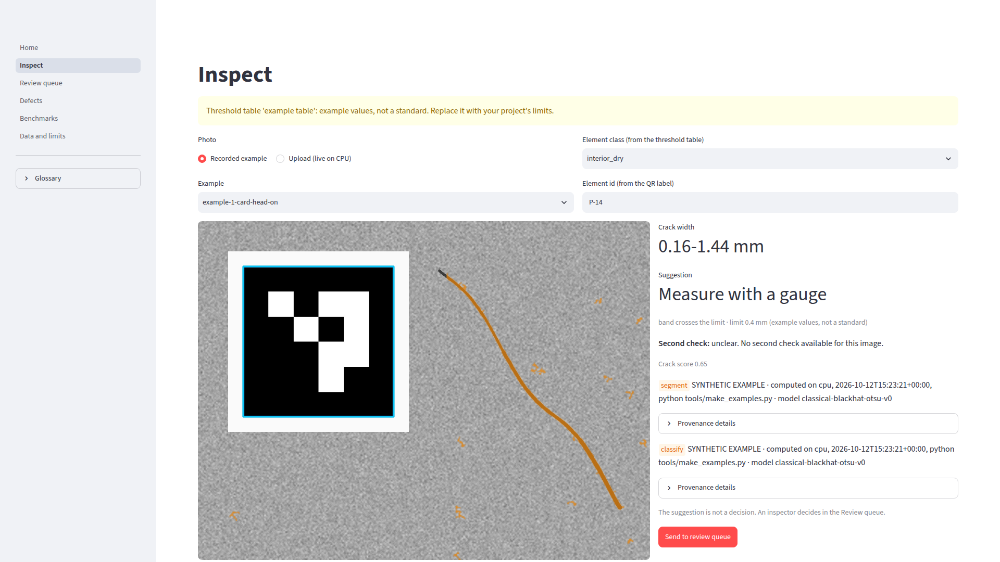

# HoldPoint

*Photos of concrete elements become crack-width ranges and a drafted defect report; the element stays on hold until an inspector decides.*

**AI measured. Human decided.**

> Built during the AMD Developer Hackathon: ACT III. Work in progress; the [Limits](#limits) section says what is
> not done yet.

**Measured so far.** Crack segmentation on 68 held-out photos (Özgenel set): UNet IoU 0.573 ± 0.006 over four
seeds, against 0.268 for a classical black-hat + Otsu baseline on the same photos and view (256 px centre crop).
On the whole photo, the way the app runs it, the released checkpoint scores 0.683 against 0.295 for the baseline
(input size chosen on the validation split). Inference speed on an NVIDIA RTX 3060: 87.5 images/s at batch 1
(512 px); on a 4-thread laptop CPU (Intel i7-7700HQ): 0.82 images/s. **Nothing has run on AMD hardware yet**; steps 4 and 5 below
need a model endpoint that is not live yet. Width in mm has been checked against crack-ruler readings on a public
field set, without our scale card: with the UNet's masks the band holds the ruler value at 75% of points for
0.5-2 mm cracks, reads wide cracks too narrow, and is not usable under 0.5 mm (see Limits).

## What it does
1. A phone photo of a concrete element, with a printed ArUco scale card in view, goes in.
2. A crack mask is segmented. Width is measured from the mask and reported as a **range in mm**, never a single
   number. Without the scale card the result is "width not measurable".
3. The range is compared with the user's own threshold table and the app suggests one of: accept, repair, measure
   with a gauge, width not measurable. There is no built-in standard; the demo table is labelled
   "example values, not a standard".
4. *(Not live yet: needs a vision-language model endpoint; without one the check says "unclear".)*
   A vision-language model gives a second opinion from a fixed vocabulary (crack, form oil stain, shadow, joint
   edge, air void, exposed rebar, unclear) and one sentence. It is not allowed to write numbers.
5. A defect report is drafted (template text until a language model endpoint is set). Every number in its text must come from the measurement fields; a draft with an
   invented number is rejected and replaced by the template text.
6. An inspector approves or overrides (with an objection code). Each decision is appended to a hash-chained log:
   who, when, model version, photo SHA-256, suggestion, decision.
7. Elements with an open defect produce one `hold` line (CSV or webhook) for whatever system releases elements
   downstream. Closing a defect needs a repair photo and a human decision.

## Screenshot


The Inspect page in recorded mode, captured from the running app with `tools/capture_app.py` (headless Chromium,
1920 x 1080). The photo is one of the **drawn** examples (synthetic texture, drawn line, drawn card), so its badges
say "SYNTHETIC EXAMPLE"; its result comes from the released UNet, run on CPU by `tools/make_examples.py`.

## Architecture
```
 phone photo + scale card
          |
          v
 +------------------+     +--------------------------------------------+
 | holdpoint.measure|     | backends (one interface, provenance on all) |
 |  ArUco -> mm/px  |<----|  cpu       UNet weights or classical fallback|
 |  homography      |mask |  recorded  replays results from a JSON file  |
 |  skeleton + EDT  |     |  amd_vllm  OpenAI-compatible endpoint        |
 |  -> width band   |     +----------------------|----------------------+
 +--------|---------+                            |
          v                                      v
 +------------------+            +-------------------------------------+
 | decide.py        |            | GPU / model server (planned)        |
 |  user threshold  |            |  UNet batch inference + bench       |
 |  table -> state  |            |  VLM second check (OpenAI API)      |
 +--------|---------+            |  run so far: RTX 3060 bench only    |
          v                      +-------------------------------------+
 +------------------+   +-------------------+   +----------------------+
 | ncr.py           |-->| ledger.py         |-->| defects/             |
 |  defect report   |   |  inspector decides|   |  lifecycle, QR id    |
 |  number guard    |   |  hash-chained log |   |  one-line hold CSV   |
 +------------------+   +-------------------+   +----------------------+
                         app/ (Streamlit): Inspect · Review queue · Defects · Benchmarks · Data & limits
```
Numbers come from deterministic code (`measure/`, `decide.py`). The language models read them and write words.

| Backend | Where it runs | Label shown in the app |
|---|---|---|
| `cpu` | local CPU; UNet weights if present, otherwise a classical image-processing fallback | "live on CPU", or "live on CPU, classical baseline (the trained UNet is not loaded)" |
| `recorded` | reads results computed earlier from a JSON file | "computed on <device>, <date>, <command>" |
| `amd_vllm` | OpenAI-compatible vLLM server (`HOLDPOINT_VLLM_BASE_URL`); not run yet | "live on AMD" |

## How to run
Python 3.12. The light install is enough for the app and the tests; torch is optional.
```bash
python3 -m venv .venv && . .venv/bin/activate
pip install -r requirements.txt          # app + tests, no torch
pip install -r requirements-ml.txt       # optional: torch + segmentation_models_pytorch for the UNet
python -m pytest -q

streamlit run app/Home.py                # http://localhost:8501
```
With Docker (light image, recorded mode, bound to 127.0.0.1 only):
```bash
docker compose up --build
```
Hosted (Streamlit Community Cloud or similar): entrypoint `app/Home.py`. The platform reads `app/requirements.txt`
(next to the entrypoint), which adds CPU-only torch, so uploaded photos run the trained UNet. The weights are
downloaded from the release below on the first uploaded photo (55 MB, a few seconds) and used only if their
sha256 matches. Measured locally on CPU: about 2 s to load torch and the model, 2-3 s per photo, peak memory
about 1.1 GB. If the weights cannot be loaded, the page says the mask comes from the classical baseline.
Useful settings:

| Variable | Meaning |
|---|---|
| `HOLDPOINT_RECORDED` | results file the `recorded` backend replays (default: `examples/recorded.json`) |
| `HOLDPOINT_UNET_WEIGHTS` | UNet weights for the `cpu` backend. Without it the app uses `runs/seg-gpu-1/model.pt` if present, else downloads the release file (when torch is installed); failing that, the classical fallback runs and says so |
| `HOLDPOINT_UNET_URL` | where the app downloads the UNet weights from (default: the v0.1-unet release); empty turns the download off |
| `HOLDPOINT_CACHE` | folder for the downloaded weights (default `~/.cache/holdpoint`) |
| `HOLDPOINT_UNET_SIDE` | long side a photo is resized to before the UNet (default 512, chosen on the validation split; the model is trained on 256 px crops, the probability map is resized back) |
| `HOLDPOINT_VLLM_BASE_URL` | vLLM endpoint for the `amd_vllm` backend |
| `HOLDPOINT_HOLD_WEBHOOK` | where the hold list is posted (optional) |

Other tools:
```bash
python -m tools.make_card results/card.pdf      # A4 scale card; print at 100 %, check the 100 mm ruler
                                                # (a copy is in docs/scale-card.pdf; the Inspect page offers it)
python -m tools.check_repo               # secrets / personal data / deny-list scan
python -m tools.results_table --write    # regenerate the table below from results/
# screenshots + clips of every page (needs a Python with playwright and a Chromium; output is not committed)
python tools/capture_app.py --chrome <path to chrome> --out results/tmp/capture
```

## Trained model
`model.pt` (55 MB) is attached to the GitHub release
[v0.1-unet](https://github.com/tunapro1234/holdpoint/releases/tag/v0.1-unet).
sha256 `1a992634324e9ef8b4fedb8e4495ea056c872eee0f8f09c46f774af60865b6a7`. Check it before use:
```bash
sha256sum model.pt
HOLDPOINT_UNET_WEIGHTS=model.pt streamlit run app/Home.py   # the cpu backend then runs the UNet
```
The code loads checkpoints with `torch.load(..., weights_only=True)` (`holdpoint/vision/common.py`), so a file
cannot run code when it is opened.

- **Model:** UNet, ResNet-18 encoder (segmentation_models_pytorch 0.5.0), 20 epochs, 256 px, trained on an
  NVIDIA RTX 3060. Not trained or measured on AMD hardware.
- **Data:** Özgenel crack segmentation set, 458 photos with real masks (CC BY 4.0, see Attribution), split once
  with a fixed seed into 321 train / 69 validation / 68 test (`data/splits/ozgenel_seg`). The best epoch is picked
  on validation; the test split is measured once, at the end.
- **Encoder pre-training:** ImageNet weights for ResNet-18 as distributed by segmentation_models_pytorch
  ([smp-hub/resnet18.imagenet](https://huggingface.co/smp-hub/resnet18.imagenet), license field "other"; the
  weights were first published by torchvision). The ImageNet images have their own terms of access
  (non-commercial research). Check both before any commercial use of this checkpoint.

Test split, 68 photos, short side resized to 256 and a 256 x 256 centre crop, threshold 0.5, pixel counts summed
over the split. Four training runs with different seeds (`results/seg-seeds-test.json`):

| Method | IoU | F1 | Precision | Recall |
|---|---|---|---|---|
| UNet, mean ± std over 4 seeds | 0.573 ± 0.006 | 0.729 ± 0.005 | 0.711 ± 0.014 | 0.747 ± 0.013 |
| Classical baseline (black-hat + Otsu), same photos and view | 0.268 | 0.423 | 0.656 | 0.312 |

Near duplicates: 3 of the 68 test photos are near copies of training photos (dHash and pHash distance 0-2 of 64
bits, `results/near-dupes-test.json`). Without them (65 photos): UNet IoU 0.568 (seed 20261012 run, the released
checkpoint) against 0.570 with them; classical 0.266.

**Whole-photo view (how the app runs).** The numbers above score a 256 x 256 centre crop at 256 px, the view used
in training. The app sees the whole photo, so the released checkpoint and the classical baseline were also scored
that way: the photo is resized to a long side of 341 or 512 px, the mask is resized back, and IoU is counted at a
long side of 1024 px (`tools/eval_fullphoto.py`, `results/fullphoto-test.json`). The app's input size, 512 px, was
chosen on the 69 validation photos before the test split was scored (`results/seg-scale.json`: validation IoU
0.673 at 341, 0.699 at 512, 0.690 at 768, 0.670 at 1024).

| Method, whole photo, scored at 1024 px | IoU, 68 photos | IoU, 65 photos (near duplicates removed) |
|---|---|---|
| UNet, input 341 px (the training scale) | 0.633 | 0.630 |
| UNet, input 512 px (app default) | 0.683 | 0.679 |
| Classical baseline, input 341 px | 0.208 | 0.208 |
| Classical baseline, input 512 px | 0.295 | 0.291 |

One checkpoint, not a mean over seeds. 0.570 (crop view) and 0.633 (whole photo, same input scale) come from the
same model; the difference is the view and the resolution the mask is scored at.

## Measurements
The table is generated from `results/bench-*.json`. Each row names the device, time and command it came from.
The files are written by `bench/bench.py` (`notebooks/bench.ipynb` is the AMD notebook; it has not been run yet):
```bash
python bench/bench.py --backend unet --checkpoint runs/seg/model.pt --images examples --device auto
# cost per 1000 images only with a price and its source; there is no default price
python bench/bench.py --backend classifier --checkpoint runs/cls/model.pt --images examples \
    --price-per-hour <USD per hour> --price-source "<where the price was read, date>"
```
Each file also keeps the device name, torch and ROCm versions, the raw `amd-smi` output ("not available" when the
tool is missing) and the git commit.

<!-- results-table:start (generated by tools/results_table.py, do not edit) -->
| file | device | measured | command | batch | iterations | warmup | images_timed | img_per_s | p50_ms | p95_ms | p50_ms_per_image | mean_ms |
|---|---|---|---|---|---|---|---|---|---|---|---|---|
| bench-cpu-20261014T202933Z.json | Intel(R) Core(TM) i7-7700HQ CPU @ 2.80GHz | 2026-10-14T20:29:33+00:00 | `python bench/bench.py --backend unet --checkpoint runs/seg-gpu-1/model.pt --images data/raw/ozgenel_seg/extracted/rgb --limit 32 --batches 1,8 --warmup 2 --iters 10 --device cpu --threads 4` | 1 | 10 | 2 | 10 | 0.818 | 1149 | 1511 | 1149 | 1222 |
| bench-cpu-20261014T202933Z.json | Intel(R) Core(TM) i7-7700HQ CPU @ 2.80GHz | 2026-10-14T20:29:33+00:00 | `python bench/bench.py --backend unet --checkpoint runs/seg-gpu-1/model.pt --images data/raw/ozgenel_seg/extracted/rgb --limit 32 --batches 1,8 --warmup 2 --iters 10 --device cpu --threads 4` | 8 | 10 | 2 | 80 | 0.748 | 9899 | 1.538e+04 | 1237 | 1.07e+04 |
| bench-unet-rtx3060.json | NVIDIA GeForce RTX 3060 | 2026-10-14T05:42:16+00:00 | `python bench/bench.py --backend unet --checkpoint runs\seg-gpu-1\model.pt --images data\raw\ozgenel_seg\extracted\rgb --limit 32 --batches 1,8,32 --warmup 2 --iters 10 --device cuda --out results\bench-unet-rtx3060.json` | 1 | 10 | 2 | 10 | 87.5 | 11.51 | 11.54 | 11.51 | 11.43 |
| bench-unet-rtx3060.json | NVIDIA GeForce RTX 3060 | 2026-10-14T05:42:16+00:00 | `python bench/bench.py --backend unet --checkpoint runs\seg-gpu-1\model.pt --images data\raw\ozgenel_seg\extracted\rgb --limit 32 --batches 1,8,32 --warmup 2 --iters 10 --device cuda --out results\bench-unet-rtx3060.json` | 8 | 10 | 2 | 80 | 105.6 | 75.34 | 77.54 | 9.417 | 75.75 |
| bench-unet-rtx3060.json | NVIDIA GeForce RTX 3060 | 2026-10-14T05:42:16+00:00 | `python bench/bench.py --backend unet --checkpoint runs\seg-gpu-1\model.pt --images data\raw\ozgenel_seg\extracted\rgb --limit 32 --batches 1,8,32 --warmup 2 --iters 10 --device cuda --out results\bench-unet-rtx3060.json` | 32 | 10 | 2 | 320 | 104.9 | 304.3 | 309.4 | 9.511 | 305.2 |
<!-- results-table:end -->

## Limits
- **Training data is not precast concrete.** SDNET2018 and Özgenel are bridge decks, walls, pavements and campus
  buildings. Accuracy on factory panels, form-oil stains and curing marks is unknown until such photos are tested.
- **Width against a crack ruler on real cracks: a first check, without the scale card.** Public field set:
  Virginia Tech Crack Quantification ROIs (CC BY 4.0), 15 cracks photographed from 3 distances, ruler readings
  0.15-8.5 mm at 5 points each. The published photos have the scale markers cropped out, so the crop size was
  fitted on 5 cracks (calibration) and every number below comes from the other 10 (150 points, of which the band
  could be placed at 147). Files: `results/vt-ruler-*.json`, `results/vt-side-select.json`.
  - *Human-drawn masks (the measurement code alone):* the local band holds the ruler value at 67% of points
    (77% for 0.5-2 mm; 56% for 2 mm and above, which read 0.78 mm low on average).
  - *The UNet's own masks:* width is measured on a second UNet pass with the photo resampled to 0.156 mm per
    input pixel. That size was chosen on the 5 calibration cracks only, out of 512 / 1024 / 1536 / 2048 px.
    The band holds the ruler value at 54% of points: 75% for 0.5-2 mm (mean error 0.56 mm), but only 36% for
    2 mm and above, which read **2.1 mm too narrow** on average.
  - **Under 0.5 mm the UNet result is not usable.** There are only 3 such points. The band holds the ruler value
    at 1 of them, and the median reads 1.4 mm too wide. At the 512 px size used for the displayed mask it holds
    none. A band under 0.5 mm is unverified; check it with a gauge.
  - *The error that matters:* the whole band at or under an example limit while the ruler reads above it. This
    happened at 0 of 147 points for 0.2 mm, 1 of 144 for 0.3 mm and 2 of 144 for 0.4 mm.
  - Disclosure: results on the 10 test cracks at 512 and 1024 px had been seen before the selection rule was
    written. The 512 px size, chosen for segmentation IoU, held the ruler value at only 36%; that is why width
    now uses its own pass.
  - The scale card has not been part of any real-crack test.
- The printed scale card has not yet been tested with real phone photos.
- Cracks under 3 pixels wide are not judged; the app says "measure with a gauge". The pixel counted is the
  model input pixel (0.156 mm on the width pass), not the phone's, because the mask cannot be finer than that.
- The bundled `examples/example-*` are **drawn** images (synthetic texture, drawn line, drawn card). Their results
  come from the released UNet run on CPU (`tools/make_examples.py`, which first checks that the mask covers at
  least 90% of the drawn line and lies on it) and are labelled as synthetic in the app. The bands read wide:
  example 1 gives 0.85-1.56 mm for a drawn 0.6-1.2 mm line, and example 2 gives 0.55-0.95 mm for a drawn
  0.3-0.5 mm line, so its band misses the true width. A drawn line is not a crack; these images show the chain,
  they do not test it.
- `examples/ozgenel-test-*` are four real test photos (the first four in split order after removing near
  duplicates), segmented by the released UNet on CPU at the app's 512 px input (IoU against the real masks
  0.45-0.75, stored in `examples/index.json`). They have no scale card, so the app gives no width in mm.
- The decision log detects edits and reordering, but not lines cut off the end of the file.
- No AMD results are in this repository yet. The table above has an NVIDIA RTX 3060 run and a laptop CPU run
  (512 px input, 32 photos); the Benchmarks page says "AMD Instinct MI300X: not measured yet" until an AMD file
  exists.
- The app does not judge structural significance, depth or cause. That is an engineer's call.

## Glossary
- **Defect report (NCR, non-conformance report):** the written record that an element does not meet its
  requirement, with what was found, where, and what happens next.
- **Hold point:** a step that the work cannot pass until someone with authority signs it off. Here: an element with
  an open defect stays on hold until an inspector closes it.
- **Inspector:** the person who decides. The app only suggests.
- **Scale card:** the printed ArUco marker that turns pixels into millimetres.
- **Width range (band):** the 10th-90th percentile of measured local widths, widened by pixel and calibration
  uncertainty.
- **Provenance:** where a result was computed: backend, device, model version, timestamp, command.

## Attribution
Datasets: Concrete Crack Segmentation Dataset (Özgenel), SDNET2018 and Concrete Crack Images for Classification
(Özgenel), all CC BY 4.0. Models and libraries:
segmentation_models_pytorch (MIT) with ImageNet ResNet-18 encoder weights (see Trained model), Qwen2.5-VL-7B-Instruct (Apache-2.0), PyTorch, OpenCV, scikit-image, NumPy.
Full citations: [ATTRIBUTION.md](ATTRIBUTION.md).

## License
MIT, see [LICENSE](LICENSE).
